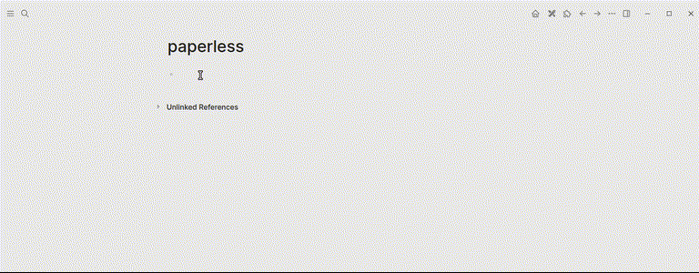

# logseq-plugin-paperless

Insert links to your [paperless-ngx](https://docs.paperless-ngx.com/) saved views and documents directly from Logseq, via slash commands.



## Status

- ✅ `/Paperless: Insert Saved View Link` — pick one of your paperless-ngx saved views from a searchable popup, insert a markdown link to it.
- ✅ `/Paperless: Insert Document Link` — full-text search your documents and insert a markdown link to one.

## Install (from source)

```sh
yarn install
yarn build
```

This produces a `dist/` folder. In Logseq:

1. Settings → Advanced → enable **Developer mode**.
2. Settings → Plugins → **Load unpacked plugin** → select this project's root folder (the one containing `package.json`, whose `logseq.main` field points at `dist/index.html`).
3. The plugin should appear in your plugin list with no errors in Logseq's console (`Ctrl+Shift+I` / `Cmd+Option+I` to open devtools).

While developing, `yarn dev` runs `vite build --watch` — Logseq loads the built `dist/` output, not a dev server, so this rebuilds on save and Logseq's plugin hot-reload picks it up.

## Configure

Open this plugin's settings in Logseq (Plugins → Paperless-ngx Links → gear icon) and fill in:

- **Paperless-ngx Base URL** — e.g. `https://paperless.example.com` (no trailing slash).
- **API Token** — from paperless-ngx: **My Profile** (user menu, top right) → API Token.

⚠️ **The API token is stored in plaintext** in Logseq's plugin settings file on disk (this is how all Logseq plugin settings work — there's no secret-masking option in the SDK). Treat it like a password: don't sync your Logseq config directory somewhere untrusted, and revoke/rotate the token in paperless-ngx if that's ever a concern.

## Usage

In any block, type `/` and search for one of:

- **Paperless: Insert Saved View Link** — popup lists your saved views; type to filter (client-side, no network round-trip per keystroke).
- **Paperless: Insert Document Link** — popup runs a live, debounced full-text search against `/api/documents/` as you type (300ms after you stop typing), showing a page-1 thumbnail plus title, correspondent, and date for each result.

Both open as a centered modal with a dimmed backdrop (not anchored to your text cursor — Logseq's cursor-position API isn't reliably available from a slash command context, so centering is the more robust default). Use ↑/↓ to navigate, **Enter** to insert a link, and cancel with **Esc**, the **✕** button, or a click outside the box.

Clicking the inserted link opens that saved view or document in the paperless-ngx **web UI**, in your browser. This requires your browser to already have an authenticated *session* with paperless-ngx — the plugin's API token is only used for the plugin's own background requests (fetching saved views / searching documents), it does not log your browser tab in.

## Troubleshooting: CORS errors

paperless-ngx's API will refuse cross-origin requests from Logseq unless it's explicitly allowed. If the saved-view command fails with a network/CORS-flavored error toast:

1. Open Logseq's devtools console (`Ctrl+Shift+I` / `Cmd+Option+I`) and look for a CORS error — it will show a blocked `Origin` value.
2. On your paperless-ngx server, add that origin to `PAPERLESS_CORS_ALLOWED_HOSTS` (comma-separated list; see the [paperless-ngx configuration docs](https://docs.paperless-ngx.com/configuration/)), then restart paperless-ngx.

The exact origin value depends on whether you're running Logseq Desktop or Logseq on the web, so there's no single fixed value to document here — check the console each time you're unsure.

## Development

```sh
yarn test        # unit tests (Vitest)
yarn coverage    # same, with a coverage report
yarn typecheck   # tsc --noEmit
yarn build       # typecheck + production build into dist/
```

Unit tests cover the paperless-ngx API client, settings validation, markdown/error helpers, the picker's keyboard/mouse/filtering behavior, and both slash commands' orchestration logic (missing-config/empty-results/error paths, popup open/select/cancel, and the document command's thumbnail cache) with mocked `logseq`/`fetch` globals — around 97% statement coverage, `main.ts`'s trivial wiring aside. What can't be unit tested — real slash-command discoverability in Logseq's `/` menu, actual popup positioning/focus behavior, settings UI rendering, and real auth/CORS behavior against a live instance — is covered by the manual checklist in Install/Usage above instead.
